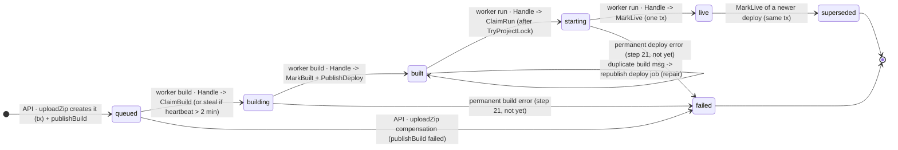
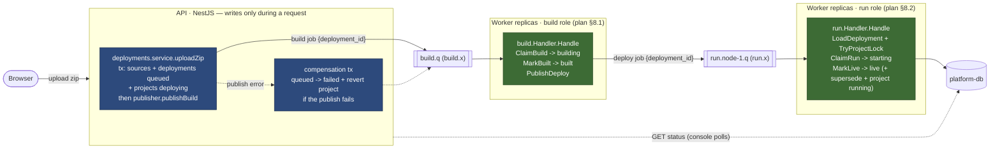

# Deployment state machine & role split

A deployment is a row in `deployments` that moves through a fixed set of
statuses (plan §7). Two parties write it, never the same transition twice:

- **API** writes only *while handling the request that creates it*
  (`queued`, and the `failed` compensation if the publish fails).
- **Worker** writes only *while processing a job* (every later transition),
  and always through an atomic **claim** (`UPDATE ... WHERE status = <expected>`)
  or **CAS** finish, so two replicas racing can never both win.

Messages carry **ids only** — workers reload all state from the DB. That is
why every arrow below can name a single function: it is the only place that
transition is allowed to happen.

## States

`queued → building → built → starting → live`, terminal `failed` /
`superseded`. A replaced live deployment becomes `superseded` — at most one
`live` per project.

Notes:

- **Self-loops are not bugs.** `built --> built` is the duplicate-delivery
  repair path; a `building`/`starting` claim can also *steal* its own state
  back when the previous worker died (heartbeat stale > 2 min), so the arrows
  "or steal" above cover a re-entry to the same state.
- **Lock-busy retry** (run role) changes no state: the message is requeued
  while the project's advisory lock is held — visible only in broker logs.
- The upload guard rejects a new deployment while one is
  `queued|building|built|starting` (409), so `failed` is always exitable via
  a fresh upload.

## Who does what

### Invariants the diagram encodes

| Rule | Why |
|---|---|
| API writes `queued` + publish-failure `failed`; worker writes everything else | state ownership — nobody double-writes a transition |
| Claims are single conditional `UPDATE`s | Postgres serializes them; exactly one replica wins per job |
| Finish steps (`MarkBuilt`, `MarkLive`) repeat the claim guard (CAS) | stale work can never overwrite fresh state |
| `MarkLive` is one transaction | readers never see "new live" without "old superseded + project running" |
| ack only after the final DB write | crash before ack → broker requeues → idempotent claim skips or repairs |

## Transition → function map

| Transition | Actor | Function | File |
|---|---|---|---|
| `[*] → queued` | API | `uploadZip` (tx insert + `publisher.publishBuild`) | `services/api/src/projects/deployments.service.ts` |
| `queued → failed` | API | compensation tx inside `uploadZip` | same |
| `queued → building` | worker · build | `Handler.Handle` → `store.ClaimBuild` | `services/worker/internal/build/build.go`, `internal/store/store.go` |
| `building → built` | worker · build | `store.MarkBuilt` (CAS) | `internal/store/store.go` |
| `built → built` (repair) | worker · build | `publishDeployJob` (republish, no state change) | `internal/build/build.go` |
| `built → starting` | worker · run | `Handler.Handle` → `store.ClaimRun` | `internal/run/run.go`, `internal/store/store.go` |
| `starting → live` + `live → superseded` + project `running` | worker · run | `store.MarkLive` (one tx, CAS) | `internal/store/store.go` |
| steal (re-enter `building`/`starting`) | worker | claim `WHERE heartbeat_at < now() - interval '2 minutes'` | `internal/store/store.go` |
| `→ failed` (permanent job error) | worker | attempt classification — **step 21, not implemented yet** | — |

Side effects on `projects` (same ownership split): upload tx → `deploying`;
`MarkLive` tx → `running` + `current_deployment_id`; API compensation reverts
`deploying` via CAS. Project `stop/start/restart` and `desired_state` arrive
with M4.
